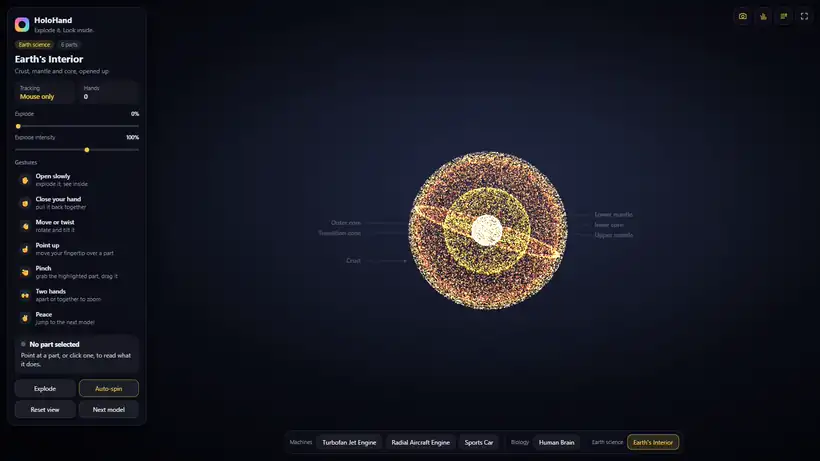
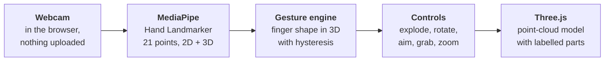
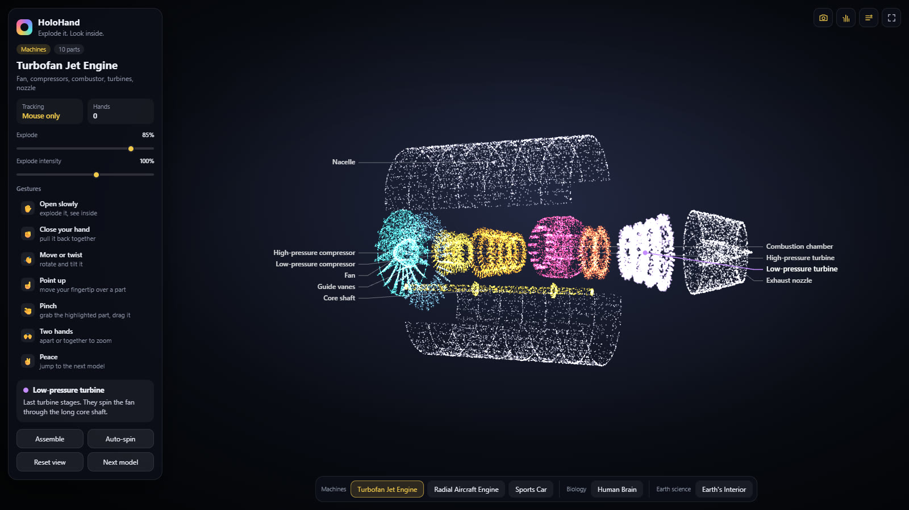
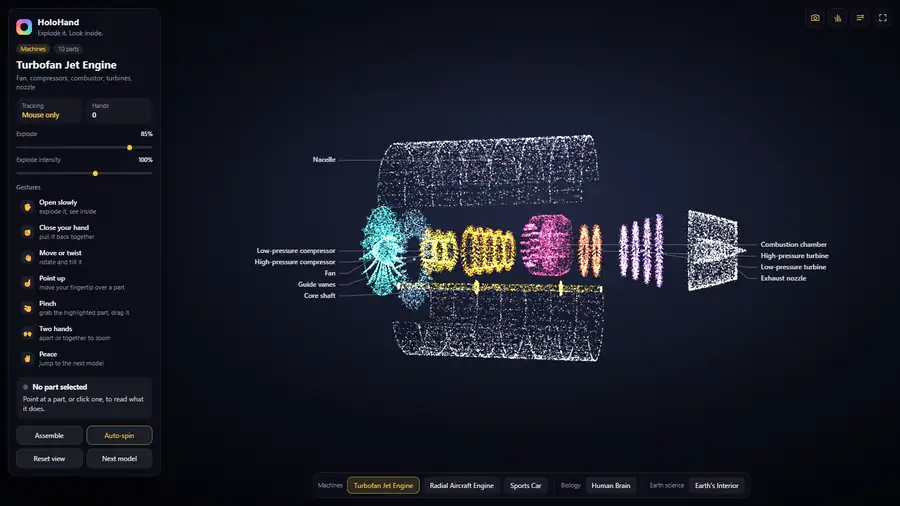
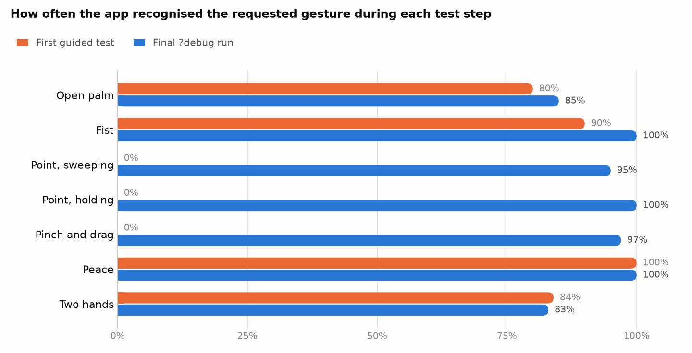

<div align="center">

# HoloHand: Earth Science Edition

Fork maintained by **[Ibaad Sidik](https://github.com/IbaadGEO)** · original project by **[Tuba Khan](https://github.com/tubakhxn)**

**Hand-controlled exploded 3D views in the browser, measured, fixed and extended with a cutaway of the Earth's interior**

[](https://github.com/tubakhxn/HoloHand-Gesture-Agent-3D)     [](LICENSE)



<sub>The Earth's Interior model opening, rotating and a layer being inspected. Recorded with the mouse in headless Chromium; with a webcam the same actions are done by hand.</sub>

</div>

## About

This is part of my wider learning in coding, data, machine learning and geoscience. It is not a professional or commissioned study.

As a geoscientist I wanted to branch out into visual, interactive tools: things that let people explore a 3D structure directly rather than read about it. I came across Tuba Khan's gesture projects and HoloHand stood out. An exploded view maps naturally onto geology, where so much is about layers you can't see from the surface.

The idea, renderer, original four models and app design are hers. Before adding anything of my own, I measured how well the gestures actually worked, fixed what the measurements showed, built a test mode so the fixes could be checked, and then added the first geological model.

## How it works



Every frame, MediaPipe finds up to two hands and returns 21 landmarks for each. The gesture engine turns them into one of open, fist, point, pinch or peace, plus how open the hand is and where the fingertip is. Those drive the model: openness explodes it, palm movement rotates it, the fingertip highlights a part and a pinch drags it out.

## What the app does



- **Open your hand** to pull the model apart; a fist puts it back together. The gold ring around your hand shows how far it is exploded.
- **Move or twist your hand** to rotate and tilt the model.
- **Point up** and move your fingertip over a part. The part lights up, its name appears next to your fingertip, and holding still locks it.
- **Pinch** to grab the part you aimed at and drag it out; let go and it snaps back.
- **Two hands** zoom; a **peace sign** jumps to the next model.
- Mouse and keyboard do everything too, and the app still works without a camera.

### Five models



<sub>Jet engine, radial engine, sports car and brain by Tuba Khan; Earth's Interior added in this fork.</sub>

## The Earth science addition

The first geological model is a cutaway of the Earth, in its own **Earth science** group (key `5`). Open your hand and it comes apart like an onion: the mantle and core layers split into top and bottom halves, each showing its cross-section, while the crust breaks into pieces that fly outward.

| Layer | Depth | Notes shown in the app |
|---|---|---|
| Crust | surface to ~35 km (5–10 km under oceans, 30–70 km under continents) | broken into 8 pieces, a simple stand-in for tectonic plates |
| Upper mantle | to 410 km | rigid top joins the crust as the lithosphere; the softer asthenosphere below lets plates move |
| Transition zone | 410–660 km | minerals squeezed into denser forms that may hold large amounts of water |
| Lower mantle | 660–2,890 km | over half of Earth's volume; hot, solid rock that creeps very slowly |
| Outer core | 2,890–5,150 km | liquid iron and nickel whose flow generates the magnetic field |
| Inner core | 5,150–6,371 km | solid iron and nickel at roughly 5,000–6,000 °C, kept solid by pressure |

Layers below the crust are drawn to scale using standard reference depths (Dziewonski and Anderson, 1981). The crust is drawn about six times thicker than real so it can be seen, and its on-screen description says so.

In live tests on this model, gestures scored as on the other models (8 of 9 test steps passing) and pinch grabbed the layer I had aimed at. One limit: on the closed globe the crust surrounds everything, so it overlaps the inner layers and the highlight flickers more (0.8 changes per second against 0–0.4 on other models). Opening the model first avoids it.

Next: a valley cross-section (rock layers, river deposits, channel) and a seabed or plate-boundary model.

## How I tested it

**1. A recorded, logged session.** I recorded 78 seconds in Chrome trying every gesture while logging what the app detected ten times a second. The detected gesture changed 133 times, 64 of them lasting 0.2 s or less. Pinch fired for 14.5 s, mostly when I wasn't pinching; point registered for 0.2 s in total; peace never switched the model; and a one-frame dropout of my second hand made two-hand zoom jolt into one-hand rotate. Frame rate was fine (median 40 fps).

**2. Offline checks (`npm test`).** A script feeds synthetic hand poses through the gesture engine with no camera. Each problem from the recording became a test case before it was fixed, and 4 of them failed on the original code. It now runs 19 checks, including values measured from my hand.

**3. Guided live tests.** An on-screen prompt asks for one gesture at a time and scores how often the app recognised it, ignoring the first second of each step while the hand changes pose.

**4. Measuring the hand directly.** Point and pinch kept failing, so I logged the finger measurements live. Pointing at the screen, the index finger points toward the camera and looks short; even MediaPipe's 3D hand squashes the depth, so my point and my pinch measured almost the same:

| | Index extension (tip-to-wrist ÷ knuckle-to-wrist) | Thumb-to-index gap (hand sizes) |
|---|---|---|
| Pointing at the screen | 1.32 | 0.22 |
| Pinching | 1.27 | 0.23 |

No threshold separates those, so the gesture design changed instead: **point upward** and move your fingertip over a part.

**5. Selection under a shaky fingertip.** Even with the gesture recognised, the highlighted part felt random: selection took the single nearest sample point, re-chosen every frame, and pinch searched again at a different spot. On the real scene with an 8 px wobble added to the cursor (an assumed figure):

| Model | Highlight changes per second | Selection locks within 1 s |
|---|---|---|
| Jet engine | 1.46 → 0.05 | 83% → 99% |
| Radial engine | 2.33 → 0.04 | 76% → 99% |
| Sports car | 2.82 → 0.12 | 77% → 97% |
| Brain | 1.98 → 0.02 | 77% → 99% |

**6. A built-in test mode (`?debug`).** The guided test is now part of the app. Add `?debug` to the URL, start the camera and click **Run test**: it prompts nine steps, then shows a pass or fail table with a **Copy results** button. Besides recognition it checks highlight steadiness, whether the part locked, whether pinch grabbed the aimed part, whether peace switched the model exactly once, and the median finger measurements for tuning. The pass marks (≥80% recognised, ≤10% false on a relaxed hand, ≤0.5 highlight changes per second) are my own suggested targets, not a standard.

## Results

<picture>
  <source media="(prefers-color-scheme: dark)" srcset="docs/media/results_dark.png">
  
</picture>

| Test step | First guided test | Final `?debug` run |
|---|---|---|
| Open palm | 80% | ✅ 85% |
| Fist | 90% | ✅ 100% |
| Move | 20% (label only; rotation worked) | ✅ 99% |
| Point, sweeping across parts | 0% | ✅ 95% |
| Point, holding on one part | 0% | ✅ 100%, locked, 0.4 highlight changes/s |
| Pinch and drag | 0% | ✅ 97%, grabbed the part I aimed at |
| Relaxed hand (should be no gesture) | 25% false point | ✅ 5% false |
| Peace | 100%, but switched model 6 times while held | ✅ 100%, exactly one switch |
| Two hands | 84% | ✅ 83% |

<sub>One person, one webcam, one room. The first guided test already included the first round of fixes; the original code was only tested in the free recording above. Other hands and lighting may need small threshold changes.</sub>

## What changed in the code

| File | Change |
|---|---|
| `src/gestureEngine.js` | Finger shape measured on MediaPipe's 3D `worldLandmarks`; each finger keeps its last state between an up and a down threshold; pinch needs a tighter gap and 4 frames; point also counts when the index clearly outreaches the other fingers; thresholds are named constants |
| `src/handTracking.js` | Also returns the 3D landmarks |
| `src/scene.js` | Sticky selection (`chooseSticky`); clear error if a model has more parts than the shader supports (24) |
| `src/main.js` | Pinch grabs the part aimed at in the last 2 s, otherwise the locked part; part name at the fingertip; peace switches once per sign; two-hand zoom waits 0.25 s and the hand already in control keeps it; `?debug` hook |
| `src/debugTest.js` | New: the guided test mode |
| `scripts/gesture-selftest.mjs` | New: offline checks for `npm test` |
| `src/models/earth.js` | New: the Earth's Interior model |
| `index.html` | Hints now say "Point up" and "Pinch grabs the highlighted part" |

## Observed, measured or assumed

| Part | Status | Source |
|---|---|---|
| Hand landmarks (2D and 3D) | Model output | MediaPipe Hand Landmarker (Zhang et al., 2020) |
| Gesture recognition percentages | Measured live, one person and setup | this fork's `?debug` test |
| Finger measurements for point and pinch | Measured live | this fork |
| 8 px fingertip wobble in the selection test | **Assumed** | this fork |
| Pass marks for the test mode | Chosen by me, not a standard | this fork |
| Layer depths | Reported | Dziewonski and Anderson (1981) |
| Crust thickness ranges | Reported, typical ranges | general geophysics references |
| Crust thickness as drawn | **Display choice** (about 6× real) | this fork |
| Inner-core temperature range | Reported, estimates vary | Anzellini et al. (2013) |
| Water in the transition zone | Reported ("may hold") | Pearson et al. (2014) |

## Built with

- **Web:** Three.js 0.170 point clouds with a custom shader, MediaPipe Tasks Vision 0.10.14 Hand Landmarker (WASM, GPU with CPU fallback), plain JavaScript, Vite 5.4.
- **Testing:** Node for the offline checks; the in-app `?debug` test for live runs.
- **README media:** recorded with Playwright (headless Chromium) and converted with ffmpeg; the results chart is drawn with matplotlib.

## References

- Anzellini, S., Dewaele, A., Mezouar, M., Loubeyre, P. and Morard, G. (2013) 'Melting of iron at Earth's inner core boundary based on fast X-ray diffraction', *Science*, 340(6131), pp. 464–466. doi:10.1126/science.1233485.
- Dziewonski, A.M. and Anderson, D.L. (1981) 'Preliminary reference Earth model', *Physics of the Earth and Planetary Interiors*, 25(4), pp. 297–356. doi:10.1016/0031-9201(81)90046-7.
- Khan, T. (2026) *HoloHand-Gesture-Agent-3D*. GitHub repository, MIT licence. Available at: https://github.com/tubakhxn/HoloHand-Gesture-Agent-3D.
- Pearson, D.G., Brenker, F.E., Nestola, F. et al. (2014) 'Hydrous mantle transition zone indicated by ringwoodite included within diamond', *Nature*, 507, pp. 221–224. doi:10.1038/nature13080.
- Zhang, F., Bazarevsky, V., Vakunov, A., Tkachenka, A., Sung, G., Chang, C.-L. and Grundmann, M. (2020) 'MediaPipe Hands: on-device real-time hand tracking', *arXiv* preprint 2006.10214.

<details>
<summary><b>Run it, test it, add a model</b></summary>

### Run

Needs Node.js 18+ and Chrome or Edge.

```bash
npm install
npm run dev      # open the URL Vite prints and click Start camera
npm test         # offline gesture and selection checks
```

Add `?debug` to the URL for the guided live test. The camera only works on `http://localhost` or `https`. `npm install` copies the MediaPipe WASM and downloads the hand model into `public/`; if that is blocked, the app fetches both from a CDN at runtime.

### Gestures

| Gesture | Effect |
|---|---|
| Open hand slowly | Explode the model. The white arc on the gold ring shows how far. |
| Close your hand / fist | Pull it back together |
| Move or twist your hand | Rotate and tilt the model |
| Point up (index finger) | Highlight the part under your fingertip; its name shows next to it. Hold still to lock it. |
| Pinch | Grab the highlighted part, drag it out, release to snap it back |
| Two hands | Move them apart or together to zoom |
| Peace sign (hold ~0.3 s) | Jump to the next model |

### Mouse and keyboard

Drag = rotate · scroll = zoom · click a part = inspect it · `Space` = explode / assemble · `←` `→` or `1`–`5` = switch model · `R` = reset view. Sliders in the left panel control the explosion and its intensity; the top-right buttons toggle camera background, hand skeleton, labels and fullscreen.

### Tips

- Even light and a plain background help. Keep your hand 40–80 cm from the camera, palm facing it.
- Open and close your hand slowly. The peace sign needs a short hold so it does not trigger by accident.

### Code layout

| Path | Role |
|---|---|
| `src/main.js` | app loop, hand overlay, gesture to action, labels, UI |
| `src/handTracking.js` | MediaPipe wrapper (2 hands, local files then CDN, GPU then CPU) |
| `src/gestureEngine.js` | landmarks to gesture, openness, smoothed palm, fingertip and pinch, wrist roll |
| `src/scene.js` | Three.js point-cloud renderer: explode, scatter transition, picking, part dragging |
| `src/models/` | `shapes.js` (point sampling) and the jet, radial, car, brain and earth models |
| `src/debugTest.js`, `scripts/gesture-selftest.mjs` | live and offline tests |

To add a model, write a `build()` that returns parts (`P(name, description, color, [I(cloud, explodeDirection)])`), keep it to 24 parts or fewer, and register it in `src/models/index.js`.

### Limitations

- Thresholds were tuned on one person's hand, camera and lighting.
- On the closed Earth globe, the crust overlaps the inner layers when you point.
- On narrow windows, some part labels can sit behind the side panel.

</details>

## Credit and licence

Original project: [tubakhxn/HoloHand-Gesture-Agent-3D](https://github.com/tubakhxn/HoloHand-Gesture-Agent-3D) by Tuba Khan, MIT licence; her copyright notice is kept in [LICENSE](LICENSE). The testing, fixes, test mode and Earth's Interior model in this fork are by Ibaad Sidik, under the same MIT licence. The animations and images in `docs/media/` are screen recordings and charts of this project.
